# Лабораторная работа №3 - Собери платформу для shop

## Часть 0 - свой сервис

Написала два сервиса на языке Go и Dockerfile к ним с multi-stage сборкой.

**api** - HTTP-сервис с эндпоинтами:
- `GET /health` - возвращает `ok`, но при выставленной переменной окружения `HEALTH_FAIL=true` отвечает 5xx
- `POST /order` - пишет заказ в `postgres`
- `GET /orders` - читает и отдаёт список заказов

**worker** - фоновый обработчик: читает заказы из `postgres` и помечает их обработанными

Схема БД - таблица `orders(id, item, status, created_at)`, подключение через переменную окружения `DATABASE_URL`.

## Часть 1 — Ограждения на кластер

Выбрала **Kyverno**, т.к. он правила описываются проще и в целом выглядит все дружелюбнее для новичка

```bash
helm install kyverno kyverno/kyverno -n kyverno --create-namespace`
```

Все политики лежат в `policies/`. Каждая действует на весь кластер (`ClusterPolicy`, `validationFailureAction: Enforce`).

**1. `require-resources.yaml` — обязательные лимиты ресурсов**

Каждый контейнер обязан указывать `requests` и `limits` по `cpu` и `memory`.
Без лимитов под может съесть все ресурсы ноды и «заморить» соседей. Лимиты гарантируют предсказуемое поведение и справедливое распределение ресурсов

Проверила, что политика работает:

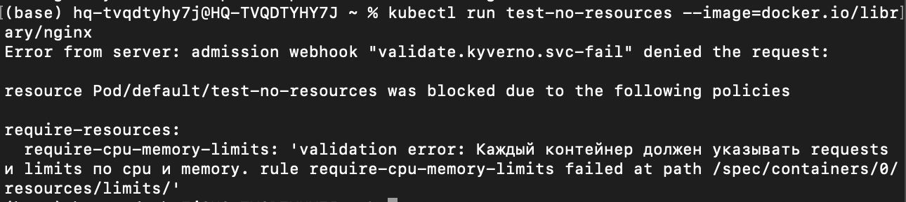

**2. `require-trusted-registry.yaml` — только доверенный реестр**
Образ контейнера обязан начинаться с `docker.io/library/`. Не даёт задеплоить образ из чужого/непроверенного реестра, который может содержать вредоносный или непроверенный код.

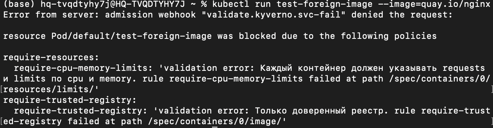

**3. `require-labels.yaml` — обязательные метки**
У пода обязана быть метка `app`.
Метки нужны для селекторов сервисов, мониторинга и управления ресурсами. Без них сложно находить и группировать поды.

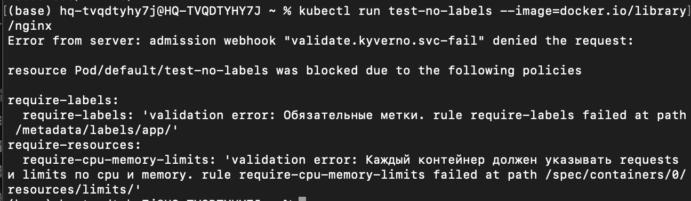

**4. `disallow-privileged.yaml` — запрет privileged-контейнеров**
Контейнер не может запускаться с `securityContext.privileged: true`.
privileged-контейнер получает доступ ко всему хосту и может сломать ноду или выйти за пределы изоляции.

**5. `disallow-root.yaml` — запрет запуска от root**
Контейнер обязан запускаться не от root (`runAsNonRoot: true`).
Запуск от root даёт процессу максимум прав внутри контейнера. Запуск от непривилегированного пользователя ограничивает ущерб

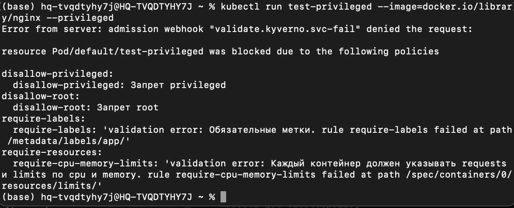

Также для удобства поставила себе Lens и нашла там свои политика кластера:

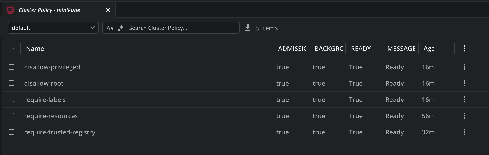

UPD: чтобы не переписывать докерфайлы и не было проблем, решила поменять рут политику на запрет latest-тегов

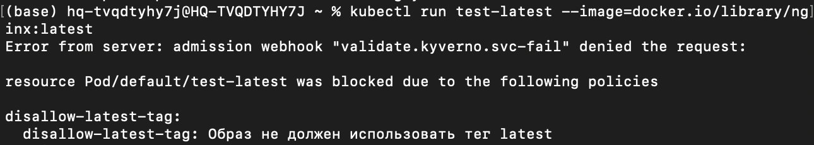

## Часть 2 - Чарт api и worker

Собираю образы с префиксом docker.io/library/,чтобы прошла политика реестра:
```bash
docker build -t docker.io/library/shop-api:v1 ./api
docker build -t docker.io/library/shop-worker:v1 ./worker
```
и загружаю их в minikube
```bash
minikube image load docker.io/library/shop-api:v1
minikube image load docker.io/library/shop-worker:v1
```

Теперь перехожу к самому чарту. Структура чарта `shop/`:

- **`Chart.yaml`** — метаданные чарта (имя, версия, `apiVersion: v2`).
- **`values.yaml`** — параметры по умолчанию: у каждого сервиса свой блок с образом, количеством реплик и переменными окружения. `api` — 3 реплики, `worker` — 2.
- **`templates/api-deployment.yaml`** — Deployment для `api`: реплики из `values`, образ с префиксом `docker.io/library/`, readiness- и liveness-пробы на `/health`, лимиты ресурсов, `securityContext` без эскалации привилегий.
- **`templates/worker-deployment.yaml`** — Deployment для `worker`: реплики из `values`, образ, лимиты ресурсов (без HTTP-проб, т.к. у worker нет `/health`).
- **`templates/api-service.yaml`** — Service для `api`, селектор по метке `app: shop-api`, порт 80 → 8080.

В шаблоны сразу заложила требования политик из Части 1: лимиты ресурсов, метка `app`, доверенный образ, pinned-тег (не latest), без privileged

Устанавливаю чарт:

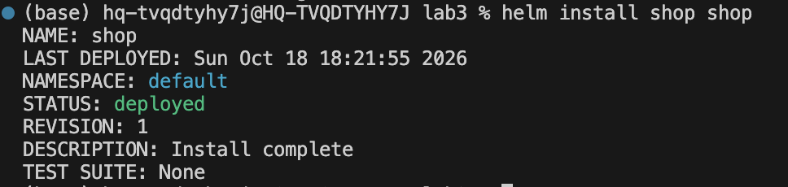

Заметила, что поды в состоянии waiting, т.к. не могут достучаться до postgres

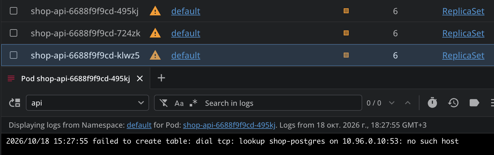

Поэтому пока **проверю reconciliation.** 
Удалю под руками и проверю, что они вернулись с новыми именами:

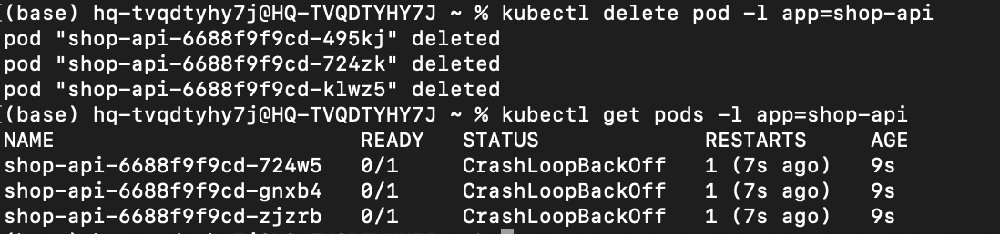

И попробую поменять количество реплик: 

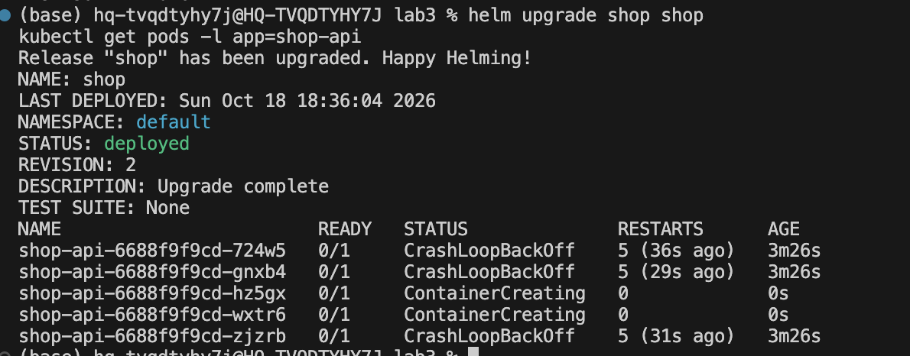

Теперь подниму postgres, чтобы поды смогли успешно завестись. Для этого напишу postgres.yaml и добавлю его. Теперь все работает в состоянии Running

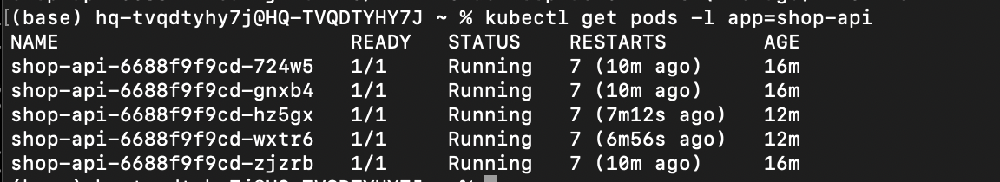

**Буду проверять Rolling Update**

Для этого соберу новую версию образа и загружу ее в minikube
```bash
docker build -t docker.io/library/shop-api:v2 ./api
minikube image load docker.io/library/shop-api:v2
```

Теперь поменяю тег в values.yaml на новый и буду смотреть /health

Для проверки rolling update собрала новую версию образа, загрузила в minikube и поменяла тег в `values.yaml`. Чтобы убедиться, что ни один запрос не провалился, запустила helper-под `curl-loop`, который в цикле долбит `/health` сервиса изнутри кластера, и параллельно сделала `helm upgrade`. Поды обновлялись по одному (rolling update), сервис оставался доступным. Единственный нюанс — при обновлении endpoints сервиса возможен микро-разрыв (доли секунды), поэтому в цикле из сотен запросов проскочил один `FAIL` с `Connection refused`. Как выяснила - это вроде особенность однонодового кластера и один фэйл здесь не критичен

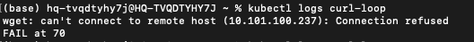

**Теперь проверю rollback сломанной версии**

Выставлю HEALTH_FAIL: "true" и обновлю хелм.
Новые поды не проходят readiness (потому что /health отвечает 5xx при HEALTH_FAIL=true), поэтому старые исправные не удаляются. rollout не завершается, старые поды остаются Running, а сервис продолжает отвечать:

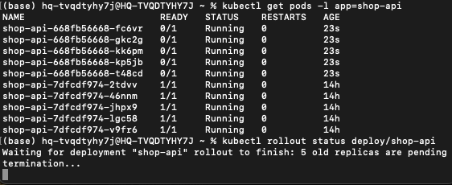

Откатываюсь на предыдущую рабочую ревизию и смотрю, что все работает:

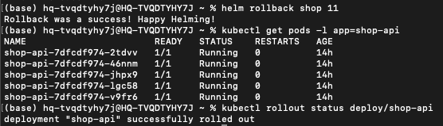