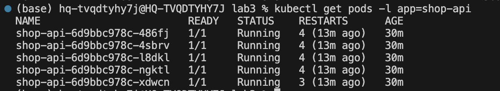
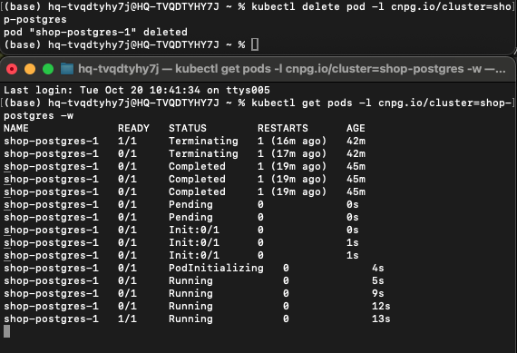
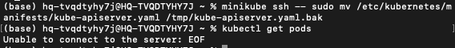
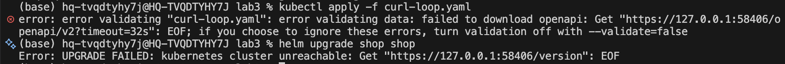
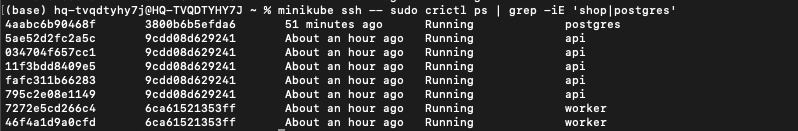
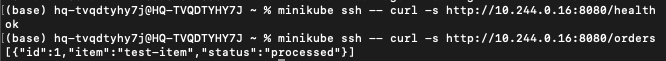
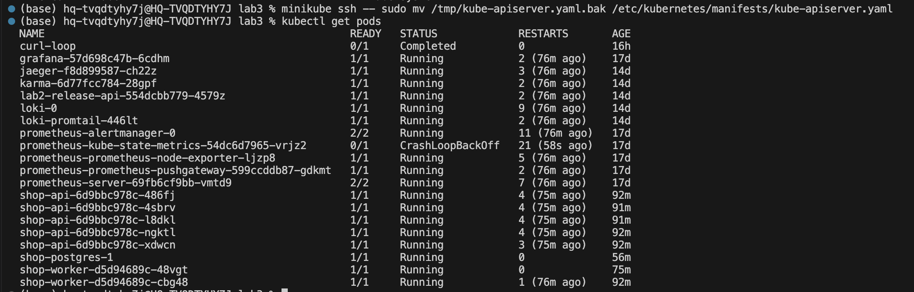
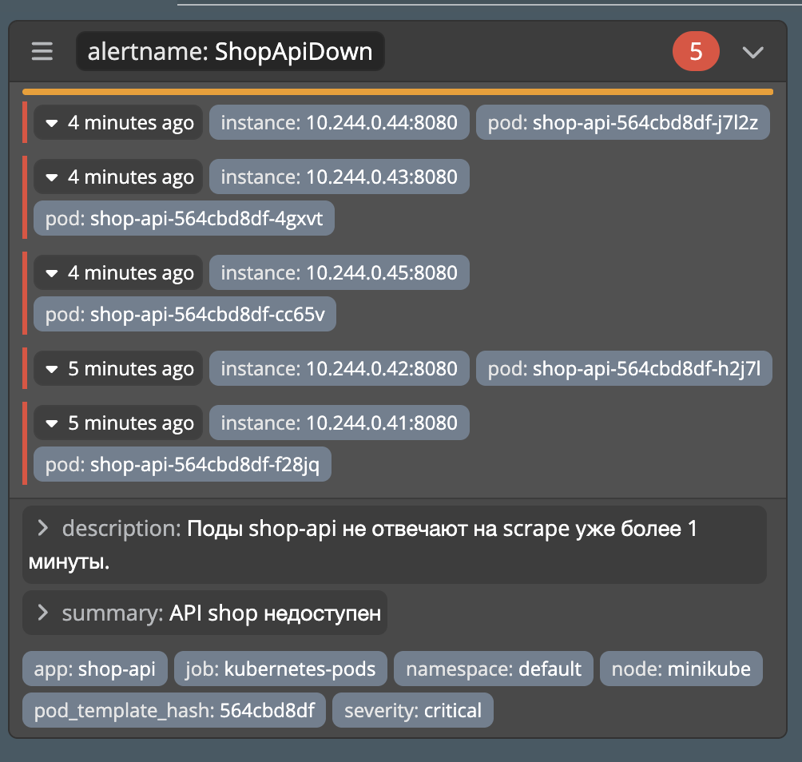

# Лабораторная работа №3 - Собери платформу для shop

## Часть 0 - свой сервис

Написала два сервиса на языке Go и Dockerfile к ним с multi-stage сборкой.

**api** - HTTP-сервис с эндпоинтами:
- `GET /health` - возвращает `ok`, но при выставленной переменной окружения `HEALTH_FAIL=true` отвечает 5xx
- `POST /order` - пишет заказ в `postgres`
- `GET /orders` - читает и отдаёт список заказов

**worker** - фоновый обработчик: читает заказы из `postgres` и помечает их обработанными

Схема БД - таблица `orders(id, item, status, created_at)`, подключение через переменную окружения `DATABASE_URL`.

## Часть 1 — Ограждения на кластер

Выбрала **Kyverno**, т.к. он правила описываются проще и в целом выглядит все дружелюбнее для новичка

```bash
helm install kyverno kyverno/kyverno -n kyverno --create-namespace`
```

Все политики лежат в `policies/`. Каждая действует на весь кластер (`ClusterPolicy`, `validationFailureAction: Enforce`).

**1. `require-resources.yaml` — обязательные лимиты ресурсов**

Каждый контейнер обязан указывать `requests` и `limits` по `cpu` и `memory`.
Без лимитов под может съесть все ресурсы ноды и «заморить» соседей. Лимиты гарантируют предсказуемое поведение и справедливое распределение ресурсов

Проверила, что политика работает:


**2. `require-trusted-registry.yaml` — только доверенный реестр**
Образ контейнера обязан начинаться с `docker.io/library/`. Не даёт задеплоить образ из чужого/непроверенного реестра, который может содержать вредоносный или непроверенный код.


**3. `require-labels.yaml` — обязательные метки**
У пода обязана быть метка `app`.
Метки нужны для селекторов сервисов, мониторинга и управления ресурсами. Без них сложно находить и группировать поды.


**4. `disallow-privileged.yaml` — запрет privileged-контейнеров**
Контейнер не может запускаться с `securityContext.privileged: true`.
privileged-контейнер получает доступ ко всему хосту и может сломать ноду или выйти за пределы изоляции.

**5. `disallow-root.yaml` — запрет запуска от root**
Контейнер обязан запускаться не от root (`runAsNonRoot: true`).
Запуск от root даёт процессу максимум прав внутри контейнера. Запуск от непривилегированного пользователя ограничивает ущерб


Также для удобства поставила себе Lens и нашла там свои политика кластера:


UPD: чтобы не переписывать докерфайлы и не было проблем, решила поменять рут политику на запрет latest-тегов


## Часть 2 - Чарт api и worker

Собираю образы с префиксом docker.io/library/,чтобы прошла политика реестра:
```bash
docker build -t docker.io/library/shop-api:v1 ./api
docker build -t docker.io/library/shop-worker:v1 ./worker
```
и загружаю их в minikube
```bash
minikube image load docker.io/library/shop-api:v1
minikube image load docker.io/library/shop-worker:v1
```

Теперь перехожу к самому чарту. Структура чарта `shop/`:

- **`Chart.yaml`** — метаданные чарта (имя, версия, `apiVersion: v2`).
- **`values.yaml`** — параметры по умолчанию: у каждого сервиса свой блок с образом, количеством реплик и переменными окружения. `api` — 3 реплики, `worker` — 2.
- **`templates/api-deployment.yaml`** — Deployment для `api`: реплики из `values`, образ с префиксом `docker.io/library/`, readiness- и liveness-пробы на `/health`, лимиты ресурсов, `securityContext` без эскалации привилегий.
- **`templates/worker-deployment.yaml`** — Deployment для `worker`: реплики из `values`, образ, лимиты ресурсов (без HTTP-проб, т.к. у worker нет `/health`).
- **`templates/api-service.yaml`** — Service для `api`, селектор по метке `app: shop-api`, порт 80 → 8080.

В шаблоны сразу заложила требования политик из Части 1: лимиты ресурсов, метка `app`, доверенный образ, pinned-тег (не latest), без privileged

Устанавливаю чарт:


Заметила, что поды в состоянии waiting, т.к. не могут достучаться до postgres


Поэтому пока **проверю reconciliation.** 
Удалю под руками и проверю, что они вернулись с новыми именами:


И попробую поменять количество реплик: 


Теперь подниму postgres, чтобы поды смогли успешно завестись. Для этого напишу postgres.yaml и добавлю его. Теперь все работает в состоянии Running


**Буду проверять Rolling Update**

Для этого соберу новую версию образа и загружу ее в minikube
```bash
docker build -t docker.io/library/shop-api:v2 ./api
minikube image load docker.io/library/shop-api:v2
```

Теперь поменяю тег в values.yaml на новый и буду смотреть /health

Для проверки rolling update собрала новую версию образа, загрузила в minikube и поменяла тег в `values.yaml`. Чтобы убедиться, что ни один запрос не провалился, запустила helper-под `curl-loop`, который в цикле долбит `/health` сервиса изнутри кластера, и параллельно сделала `helm upgrade`. Поды обновлялись по одному (rolling update), сервис оставался доступным. Единственный нюанс — при обновлении endpoints сервиса возможен микро-разрыв (доли секунды), поэтому в цикле из сотен запросов проскочил один `FAIL` с `Connection refused`. Как выяснила - это вроде особенность однонодового кластера и один фэйл здесь не критичен


**Теперь проверю rollback сломанной версии**

Выставлю HEALTH_FAIL: "true" и обновлю хелм.
Новые поды не проходят readiness (потому что /health отвечает 5xx при HEALTH_FAIL=true), поэтому старые исправные не удаляются. rollout не завершается, старые поды остаются Running, а сервис продолжает отвечать:


Откатываюсь на предыдущую рабочую ревизию и смотрю, что все работает:


## Часть 3 - постгрес через оператор

Решила использовать CloudNativePG. Устанавливаю его через helm
```bash
helm repo add cnpg https://cloudnative-pg.github.io/charts
helm repo update
helm install cnpg cnpg/cloudnative-pg -n cnpg-system --create-namespace
```
Здесь столкнулась с срабатыванием своих политик))) Добавлю исключение в политики на этот случай в виде блока exclude.

Оператор успешно запустился, теперь удаляю простой postgres и добавляю в чарт шаблон postgres-cluster.yaml

На этом моменте еще забыла выставить HEALTH_FAIL в false и долго не понимала, что не так с моими подиками( Потом сервис не мог подключиться к постгре, потому что пароль не тот. Потом оказалось что в миникубе закончилась память и пришлось его рестартить. Но я его победила и все сервисы успешно стартовали:



**Проверяю reconciliation оператора.** Удаляю под postgres руками и смотрю, что оператор его вернул:



Видно, что под прошёл полный цикл `Terminating → Completed → Pending → Init → Running → 1/1`. Оператор не просто перезапустил старый под, а пересоздал его с правильной конфигурацией (init-контейнер, сертификаты, настройки). Кластер снова в состоянии `Cluster in healthy state`.

**Смотрю spec и status кластера.** У CloudNativePG есть кастомный ресурс `Cluster`, у которого разделены желаемое и наблюдаемое состояние:

- **`spec`** — что я хочу: образ `ghcr.io/cloudnative-pg/postgresql:18.6`, `instances: 1`, bootstrap через `initdb` (база `app`, владелец `app`), параметры postgresql, мониторинг.
- **`status`** — что оператор реально сделал: сгенерированные сертификаты (`shop-postgres-ca`, `-server`, `-replication`), условия (`Initialized`, `Unique`), состояние кластера.

**Чем оператор отличается от обычного controller-manager.** Обычный Deployment (как в Части 2) умеет только поддерживать желаемое число подов: упал под — пересоздал такой же. Оператор же знает про домен (postgres): он сам генерирует и ротирует TLS-сертификаты, создаёт сервисы `-rw/-r/-ro` (read-write / read / read-only), управляет бутстрапом базы через `initdb`, следит за состоянием кластера и умеет делать failover между репликами. То есть оператор — это controller-manager, который понимает не просто «поды», а конкретную сущность (в моём случае — кластер PostgreSQL) и поддерживает её согласованное состояние целиком

## Часть 4 - падение control plane

Control plane — это static pods в kube-system, манифесты лежат в /etc/kubernetes/manifests/ в миникубе. Чтобы остановить apiserver, достаточно убрать его манифест из этой папки — kubelet остановит под:
```bash
minikube ssh -- sudo mv /etc/kubernetes/manifests/kube-apiserver.yaml /tmp/kube-apiserver.yaml.bak
```
Как и ожидалось, получаю теперь ошибку подключения:



И никакие изменения также не проходят



Теперь проверю, что api/worker/postgres продолжают отвечать. Так как apiserver лежит, kubectl не работает, но поды живут. Проверю изнутри minikube, обратившись к сервису напрямую



контейнеры api (5 шт), worker (2 шт) и postgres (1 шт) со статусом Running

Проверю наверняка, что они отвечают:



Теперь возвращаю control plane и проверяю, что кластер снова управляем:



## Часть 5 — Мониторинг

Для мониторинга использую стек из Лабы 2 (prometheus, grafana, loki, jaeger, karma) — новый не поднимаю.

Оказалось, что метрики то я еще не добавила. Чтобы prometheus было что собирать, добавила в api клиент Prometheus: счётчик `shop_api_http_requests_total` (по handler и коду ответа) и гистограмму `shop_api_http_request_duration_seconds`. Эндпоинт `/metrics` отдаёт метрики. Пересобрала образ и загрузила в minikube.

Добавляю в чарт шаблоны ServiceMonitor и PrometheusRule - `servicemonitor.yaml` и `prometheusrule.yaml`. ServiceMonitor указывает prometheus собирать метрики с сервиса `shop-api` PrometheusRule содержит 3 правила алертов.

1. **ShopApiDown** — `up{app="shop-api"} == 0` в течение 1 мин. Полный простой api — пользователи не могут оформить заказ. Действия дежурного: посмотреть события пода (`kubectl describe pod`), убедиться, что под не убит и не в CrashLoopBackOff.

2. **ShopApiHighErrorRate** — доля 5xx > 50% за 5 мин. Почему важно: пользователи получают ошибки и не могут завершить сценарий. Действия дежурного: посмотреть логи в Loki с фильтром status >= 500, найти проблемный спан в Jaeger, проверить доступность БД.

3. **ShopApiHighLatency** — p95 времени ответа > 1 сек за 5 мин. Почему важно: сервис формально жив (отдаёт 200 OK), но клиенты отваливаются по таймауту, очередь запросов копится, что может привести к каскадному сбою. Действия дежурного: изучить водопад спанов в Jaeger, чтобы понять, какая операция забирает время, проверить ресурсы CPU у пода.

Теперь спровоцирую алерт. Выставила `HEALTH_FAIL=true` (тогда `/health` отвечает 503) и сгенерировала трафик на поды api. Доля 5xx стала 100%. Правило `ShopApiHighErrorRate` сначала перешло в `pending` (условие выполнено, идёт выдержка `for: 2m`), а затем в `firing`:



После проверки вернула `HEALTH_FAIL=false`, api снова здоров