# Лабораторная работа №4 - SLA критического пути под перегрузкой

## Часть 0 - сервис batch

Сгенерировала batch сервис, который в бесконечном цикле жрёт CPU и память, не делая ничего полезного.

Потребление настраивается через переменные окружения:

| Переменная | Назначение |
|---|---|
| `CPU_WORKERS` | сколько воркеров жгут CPU (по одному на ядро) |
| `MEMORY_MB` | сколько MiB памяти держать резидентной |
| `MEMORY_GROWTH_MB` | на сколько MiB/сек расти (0 = не расти) |
| `MEMORY_MAX_MB` | потолок роста (0 = без потолка) |

Скопировала чарт из лабы 3 и добавила туда шаблон `templates/batch-deployment.yaml` 

Сборка и загрузка образа:
```bash
docker build -t docker.io/library/shop-batch:v1 ./batch
minikube image load docker.io/library/shop-batch:v1
```

Развёртывание:
```bash
helm upgrade --install shop ./shop
```

Также из интереса решила поставить ArgoCD, так визуально понятнее, что происходит в кубе (и мне было интересно как он вообще настраивается)

Вот так вот там все выглядит сейчас:

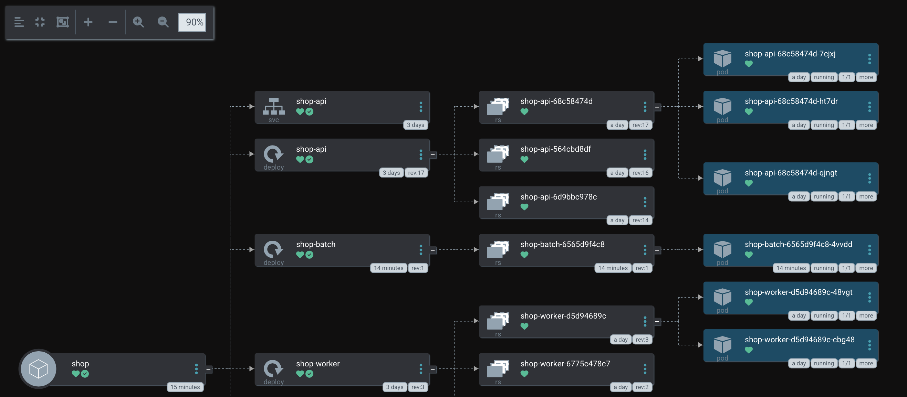

(подкрутила, чтобы количество исторических лимитов хранилось только 2 и количество реплик shop-api уменьшила до трех, чтобы не выглядело все монструозно)

## Часть 1 - выбери механизм разнесения

Сначала разберусь с самими механизмами:

1. podAntiAffinity — правило «не ставь под на ту же ноду, где уже стоит под с меткой X»
2. topologySpreadConstraints — распредели поды равномерно по доменам топологии (ноды, зоны, регионы)

Получается, что podAntiAffinity - это жесткое правило разносить реплики на разные ноды для отказоустойчивости реплик, а topologySpreadConstraints это что-то более современное и гибкое для равномерной загрузки. 

Я решила остановиться всего на двух нодах, поэтому преимущества механизма topologySpreadConstraints особо и не раскроются. Так что воспользуюсь правилом podAntiAffinity.

```yaml
  scheduling:
    mode: podAntiAffinity 
```

Но здесь важно понимать, что если у меня 3 реплики и всего 2 ноды, то третья реплика останется в состоянии Pending. Чтобы такого не было я буду использовать мягкое антиаффинити (preffered). Если нод не хватает, то планировщик поставит реплику на уже занятую ноду.

## Часть 2 - Тесная площадка

Что вообще такое этот k3d?

По сути это инструмент, который запускает k3s (облегчённый Kubernetes от Rancher) внутри Docker-контейнеров. То есть каждая нода кластера — это обычный Docker-контейнер, в котором крутится k3s

k3d = k3s (лёгкий Kubernetes) + Docker (как среда для нод)

Подняла кластер k3d строго на 2 ноды, чтобы легко получить нехватку ресурсов:

```bash
k3d cluster create lab4 --agents 1 --servers 1
kubectl config use-context k3d-lab4
```

Добавила batch новым шаблоном в чарт:

```bash
helm upgrade --install shop ./shop
```

Дальше пришлось повозиться, потому что с первого раза ничего конечно не получается. Загрузила образы в k3d, установила операторы и kyverno с политиками из прошлой лабы

В итоге весь стек поднялся:

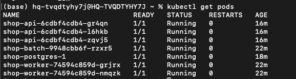

Проверила критический путь: `api` отвечает `ok` на `/health`, таблица `orders` создана.

## Часть 3 - Реальные числа вместо угадывания

Для начала поставила генератор нагрузки hey. А также анализатор потребления krr. Ставила из исходников, т.к. brew-вариант падал из-за устаревших command line tools

Пробросила порт shop-api и прогнала нагрузку по критическому пути /order:

```bash
kubectl port-forward -n default svc/shop-api 8081:80
hey -z 300s -c 20 -m POST -H "Content-Type: application/json" \
  -d '{"item":"load"}' http://localhost:8081/order
```

Первый прогон оказался слишком тяжелым (без ограничения QPS):


api был не хватало цпу: request 100m, а под нагрузкой ему оказалось, что нужно было ~1.6 ядра (это я увидела как раз через krr). Из-за этого вставки в postgres падали (500-е), а в логах postgres видны чекпоинты по 200+ секунд

Проблема была ещё и в том, что krr агрегирует потребление за окно истории (минимум 1 час), и в него попадали данные всех прогонов. Пришлось пересоздать Prometheus, чтобы данные почистились и прогнала нагрузку с ограничением QPS:

```bash
hey -z 300s -c 10 -q 20 -m POST -H "Content-Type: application/json" \
  -d '{"item":"load"}' http://localhost:8081/order
```

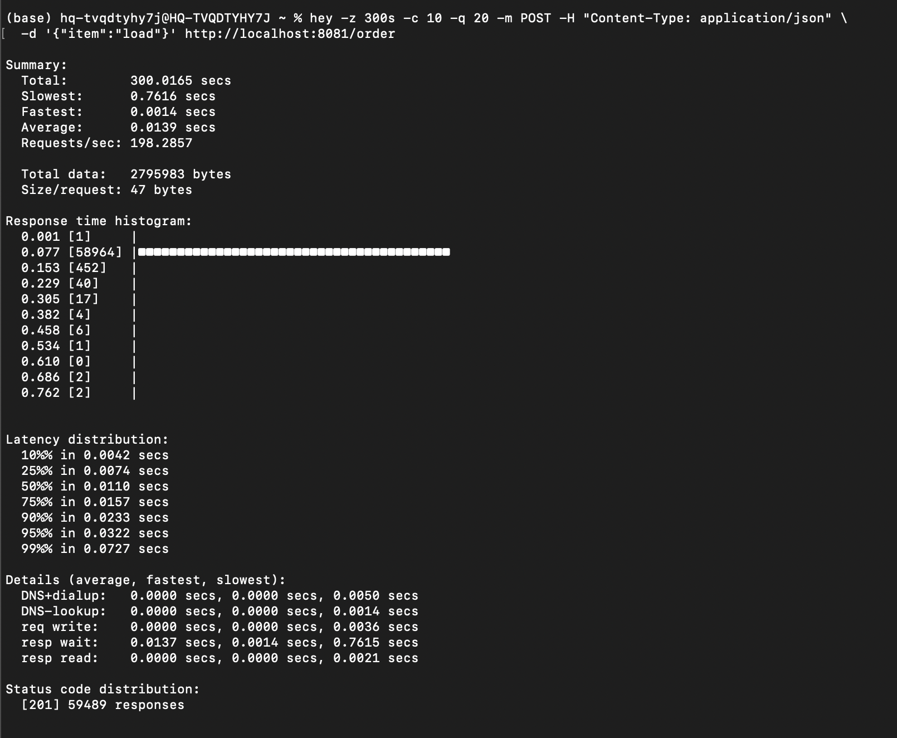

Теперь все получилось без ошибок и krr показал более реалистичные цифры, которые я могу дать

```bash
cd /tmp/krr && python3 krr.py simple -n default -p http://127.0.0.1:9090 \
  --history_duration=1 --timeframe_duration=0.5 --points_required=10 \
  -f json --fileoutput /tmp/krr-report.json
```

|  | request | limit | krr request | Severity |
|---|---|---|---|---|
| shop-api | 100m / 128Mi | 256Mi | 274m / 100Mi | OK |
| shop-batch | 100m / 128Mi | 512Mi | 1003m / 100Mi | CRITICAL |
| shop-worker | 100m / 128Mi | 256Mi | 10m / 100Mi | GOOD |

krr не смог проанализировать postgres: CloudNativePG создаёт поды напрямую (не через стандартный Deployment/StatefulSet), а krr сканирует только стандартные workload-типы. Поэтому потребление postgres посчитала напрямую из Prometheus той же методикой (95-й перцентиль CPU, пик памяти):

```bash
# CPU 95-й перцентиль
quantile_over_time(0.95, sum(rate(container_cpu_usage_seconds_total{pod=~"shop-postgres.*",container="postgres"}[5m]))[1h:1m])
# Память пик
max_over_time(container_memory_working_set_bytes{pod=~"shop-postgres.*",container="postgres"}[1h:1m])
```

| Метрика | Значение |
|---|---|
| CPU (95-й перцентиль) | 522m |
| CPU (среднее) | 82m |
| Память (пик) | 170Mi |

**Итоги:**
- **api** - я недооценила нагрузку на критический путь. Под реальным трафиком api упирается в CPU, а request 100m его душил, krr рекомендует поднять CPU почти в 3 раза
- **batch** - он специально жжёт CPU (`CPU_WORKERS=1`), поэтому ему нужно ~1 ядро, а не 100m, это было ожидаемо. Ничего менять для него не буду
- **worker** - простаивает и 100m были с огромным запасом, можно уменьшить в 10 раз
- **postgres** — потребляет 0.5 ядра и 170Mi под нагрузкой.

Итоговые значения, которые прописала в values.yaml:

| | Request CPU | Request Mem | Limit |
|---|---|---|---|
| shop-api | 274m | 100Mi | 256Mi |
| shop-worker | 10m | 100Mi | 256Mi |
| postgres | 522m | 170Mi | 512Mi |

## Часть 4 - Разнеси критический сервис

в Части 1 я выбрала механизм разнесения podAntiAffinity (мягкое, `preferred`). Теперь применяю его к сервису api

Оказалось, что в шаблоне `api-deployment.yaml` affinity вообще не был подключён — параметр `scheduling.mode` из `values.yaml` никуда не рендерился. Добавила в шаблон логику, управляемую этим параметром:

После `helm upgrade` реплики api разложились по нодам:

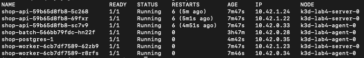

**Как это повышает отказоустойчивость:** если одна нода выйдет из строя, на второй ноде останутся живые реплики api. Без антиаффинити все реплики могли бы оказаться на одной ноде и её отказ уронил бы весь сервис

Интересно еще, что воркер тоже разнесся по разным нодам. Оказалось, что по дефолту планировщик и без правил старается разносить поды на разные ноды, но это все же не гарантированно, поэтому правила все таки стоит использовать

## Часть 5 - Приоритеты и гарантии

Добавила в чарт шаблоны `priorityclass.yaml` и `pdb.yaml`, значения через `values.yaml`

**PriorityClass**

Два класса приоритета:

| Класс | Значение | Кому |
|---|---|---|
| `shop-critical` | 1000 | api, postgres |
| `shop-low` | 100 | batch, worker |

Чем выше значение — тем важнее под. При нехватке ресурсов поды с более низким приоритетом вытесняются, чтобы освободить место для более высоких

**QoS-классы**

Он определяется соотношением requests и limits:

- **Guaranteed** - у каждого контейнера requests == limits и по цпу, и по памяти. Самый защищённый класс. Здесь я все таки проставила лимиты по цпу, хотя на лекции обсуждалось, что best practice не ставить лимит по цпу во избежании тротлинга.
- **Burstable** - есть requests/limits, но не все равны (requests < limits)
- **BestEffort** - нет ни requests, ни limits. Самый незащищённый

Я настроила:

|  | QoS | requests | limits |
|---|---|---|---|
| api | **Guaranteed** | 274m / 100Mi | 274m / 100Mi |
| postgres | **Guaranteed** | 522m / 170Mi | 522m / 170Mi |
| batch | **Burstable** | 100m / 128Mi | 512Mi |
| worker | **Burstable** | 10m / 100Mi | 256Mi |


**PodDisruptionBudget**

Для api добавила pdb с minAvailable: 2 - при добровольных прерываниях всегда остаётся минимум 2 реплики api

**Что это все дает?**

Порядок вытеснения при нехватке ресурсов определяется сначала QoS, потом приоритетом:

1. **BestEffort** - вытесняется первым (у меня таких нет)
2. **Burstable** - вытесняется следующим, если превышает свои requests
3. **Guaranteed** - вытесняется последним, только если превышает свои limits.

Внутри одного QoS-класса решает приоритет: поды с shop-low вытесняются раньше, чем с shop-critical.

Получается, что при давлении на ноду kubelet в первую очередь убьёт batch (Burstable + низкий приоритет), а api и postgres (Guaranteed + высокий приоритет) останутся

## Часть 6 - Создай нехватку, поймай preemption

**Pending**

Подняла количество реплик batch до 8 и запрашиваемый цпу увеличила до 4 ядер. И теперь кластер (2 ноды по 12 цпу) перестал всё вмещать: 4 пода batch остались в Pending:

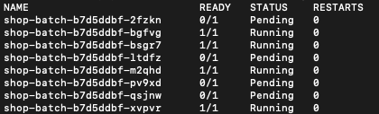

Сам планировщик объяснил это вот так:

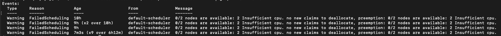

планировщик считает по requests, а не по факту потребления. У batch стоит requests 4 ядра на каждый под, хотя реально он жжёт 1 ядро. На нодах по requests уже занято 76% и 73% CPU, свободного места на очередной 4-ядерный под не хватает:

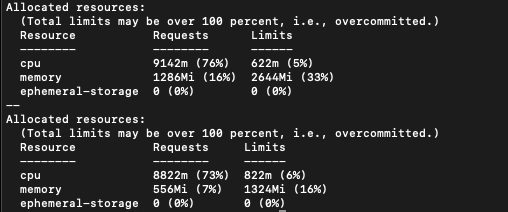

**Preemption**

Чтобы поймать preemption и не плодить большое количество api, временно подняла его цпу до 5. Планировщик увидел, что api имеет приоритет `shop-critical` (1000), а batch - `shop-low` (100). Поэтому вытеснил 3 пода batch, чтобы разместить api

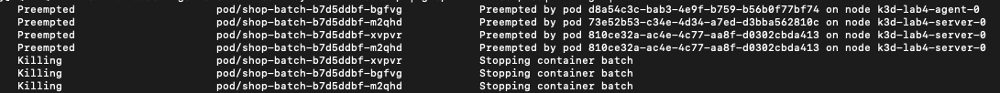

Это и есть preemption, когда высокоприоритетный под забирает место у низкоприоритетного. В итоге общее количество подов выглядит так:

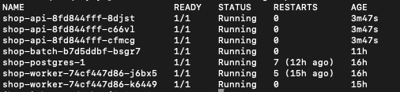

После всех этих манипуляций возвращаю api и batch CPU по-меньше

## Часть 7 - Давление по памяти, порядок жертв

Посмотрели на цпу, теперь будем вытеснять по памяти. Вот тут я намучилась больше всего, потому что долго не могла поймать именно eviction, а не OOMKilled.

Сначала я просто подняла потребление batch (MEMORY_MB=2000, рост до 2800) и реплики до 5, надеясь, что нода уйдёт в MemoryPressure и kubelet начнёт выселять. Но вместо Evicted поды уходили в OOMKilled:

```
shop-batch-...-92lp7   0/1   OOMKilled
shop-batch-...-srz22   0/1   OOMKilled
```

Поэтому решила до конца разобраться в чем же разница у этих механизмов

| | OOMKilled | Evicted |
|---|---|---|
| Кто убивает | cgroup OOM killer (ядро) | kubelet |
| Причина | под превысил свой лимит | **нода** исчерпала память |
| Что происходит | контейнер рестартует | под выселяется с ноды |
| Зависит от | limits.memory | QoS + приоритет + давление ноды |

Потом я случайно оставила у batch requests.memory: 4000Mi. Планировщик считает по requests, а не по факту потребления, поэтому поды просто не влезали и висели в Pending, это мы уже проходили.

Затем было еще миллион попыток и я уже с закрытыми глазами могу писать все команды

В итоге я создала кластер с настроками по eviction-hard. И все заработало как надо! Увидела долгожданный evicted у batch

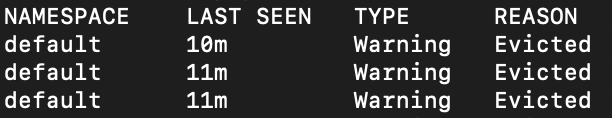

## Часть 8 - Докажи SLA под нагрузкой

Теперь нужно доказать, что критический путь держит SLA даже под перегрузкой, когда batch жрёт ресурсы

Условимся на таком SLA:

**95% заказов оформляются быстрее 300 мс, даже когда нода под перегрузкой (batch жрёт память).**

Пробросила порт shop-api и прогнала hey по критическому пути /order параллельно с тем, что batch жрёт ~4.8 GiB памяти (4 пода по ~1.2 GiB):

```bash
kubectl port-forward svc/shop-api 8081:80
hey -z 30s -c 20 -m POST -H "Content-Type: application/json" \
  -d '{"item":"load"}' http://localhost:8081/order
```

Результаты hey

```
Total:        30.15 secs
Requests/sec: 184.5
Slowest:      315 ms
Average:      108 ms

Latency distribution:
  50% in 102 ms
  90% in 195 ms
  95% in 201 ms   <-- p95
  99% in 248 ms

Status code distribution:
  [201] 5563 responses   <-- 0 ошибок
```

SLA держится!!! p95 = 201 мс < 300 мс, и даже p99 = 248 мс < 300 мс. При этом 0 ошибок

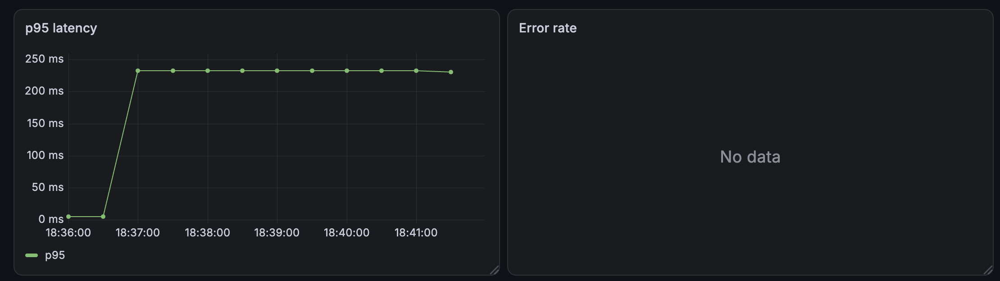

Под перегрузкой деградирует именно batch, он жрёт память и цпу, его поды перезапускаются/выселяются

## Часть 9 - Мониторинг

Добавила в чарт шаблоны ServiceMonitor и PrometheusRule, используя стек из лабы 2

и добавила 3 алерта:

| Алерт | Выражение | Severity | Зачем |
|---|---|---|---|
| `ShopApiDown` | up{app="shop-api"} == 0 | critical | Критический путь недоступен |
| `ShopApiHighErrorRate` | доля 5xx > 50% за 5 мин | warning | Критический путь деградирует, много ошибок|
| `ShopApiHighLatency` | p95 задержки > 1 сек за 5 мин | warning | Критический путь тормозит и SLA под угрозой |

Чтобы показать алерт в горящее состояние, прогнала нагрузку по /order. Под перегрузкой часть запросов к api падала с 500:

Нашла сработавшиу алерт в карма и прометеусе:

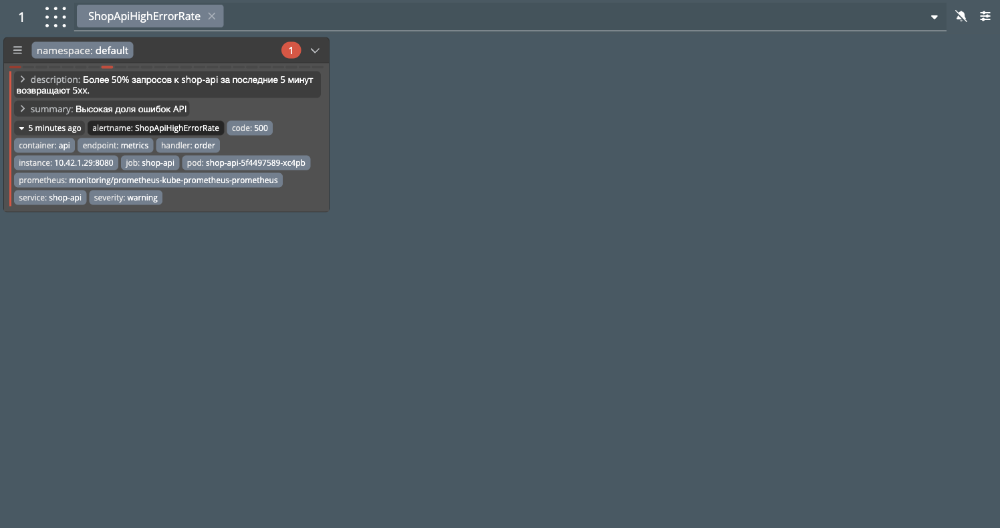

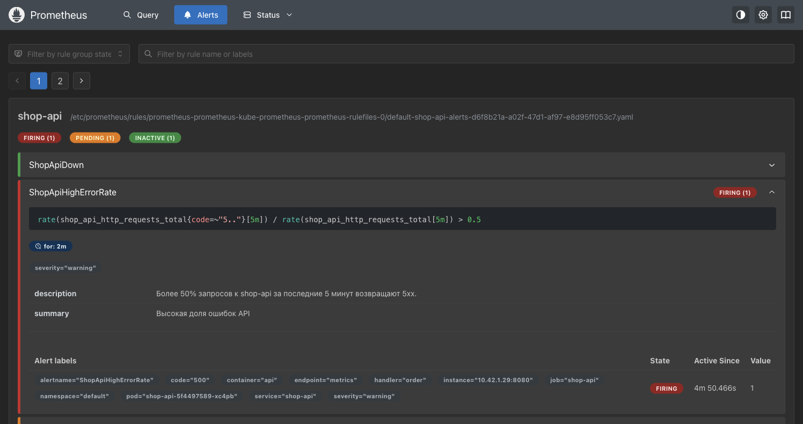

## Вывод

Главный вывод, что эту лабу я делала кажется 3 дня, когда планировала все за один вечер....:(

Ну и получается, что чтобы критический путь пережил перегрузку, нужно не просто поставить лимиты, а продумать всю схему: разнесение, приоритеты, мониторинг. Тогда под давлением деградирует второстепенное (batch), а критическое (api → postgres) держит SLA


