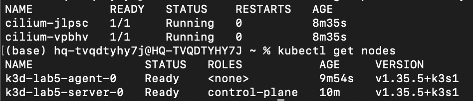
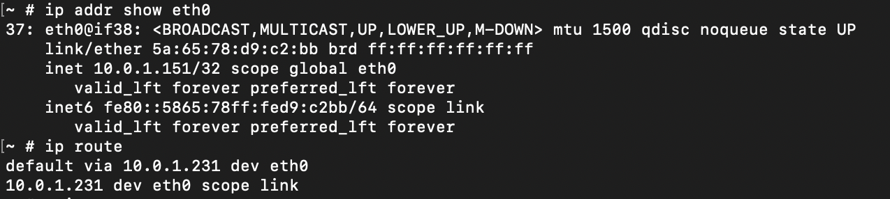
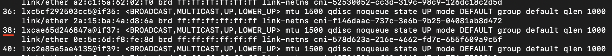
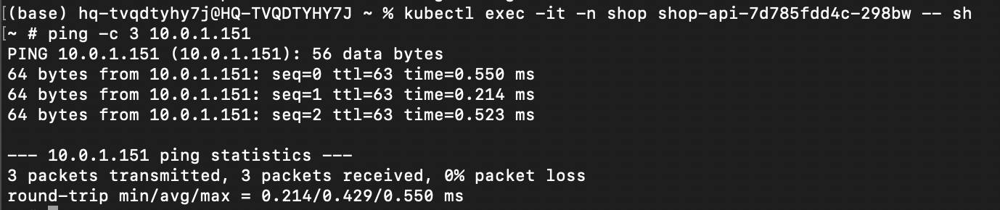
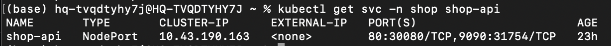
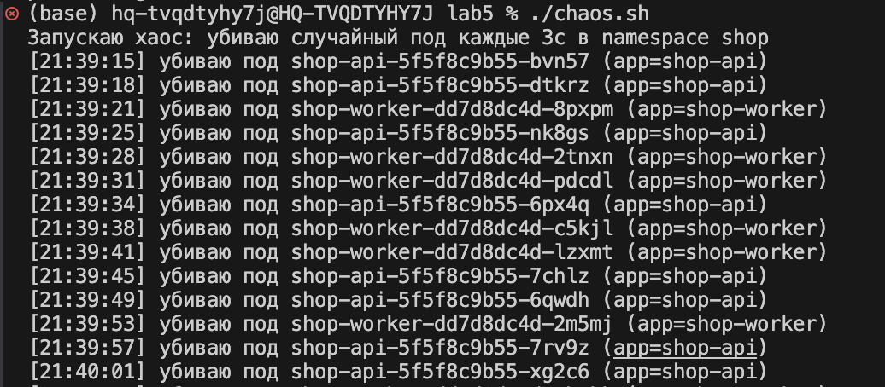
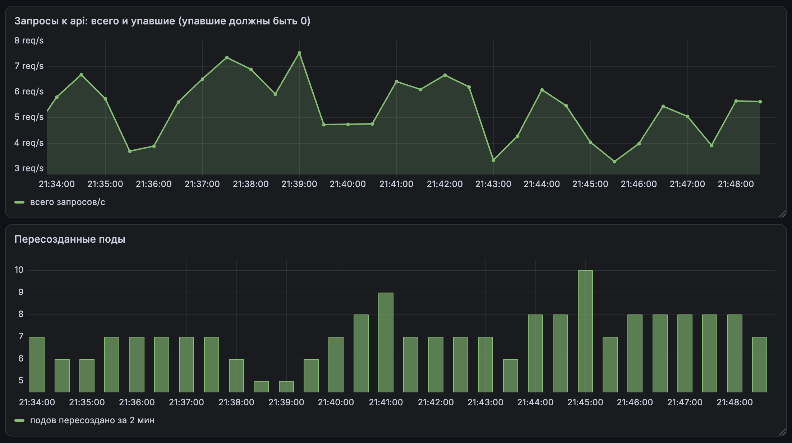
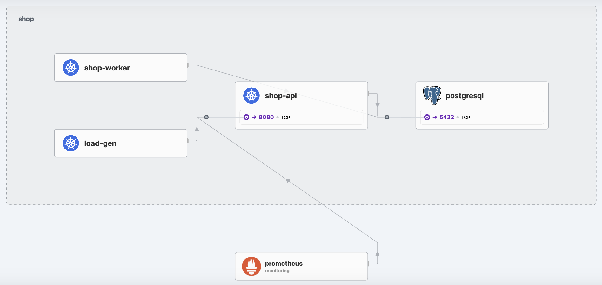

# Лабораторная работа №5 — Zero-trust сеть с доказательством

## Часть 0 — Выбор CNI

Сначала разберёмся, зачем вообще что-то выбирать

В Kubernetes есть штука под названием NetworkPolicy - это правила вида «кто к кому может ходить». Но сам Kubernetes эти правила не исполняет. Их исполняет специальный плагин CNI. А в k3d по умолчанию стоит flannel, который на эти правила просто забивает: правило ты создашь, а оно не будет работать. Поэтому нам нужен CNI, который умеет применять NetworkPolicy

Немного поресерчив, я выбрала **Cilium**. Почему:

1. Он реально применяет политики. Работает через eBPF - это такая штука, которая позволяет выполнять правила прямо в ядре Linux, быстро и надёжно.

2. У него есть Hubble - карта трафика. Hubble показывает, кто с кем общается и какие соединения блокируются. То есть я не буду гадать, а просто увижу проблему на карте

3. Может запрещать даже по приложению.

4. Вроде как он легко ставится:)

Calico - тоже нормальный и надёжный вариант, его часто используют. Но у него нет такой удобной карты трафика, как Hubble, а она мне точно пригодится

Поднимаю кластер без дефолтного CNI и без политик с двумя нодами

```bash
k3d cluster create lab5 \
  --servers 1 --agents 1 \
  --k3s-arg "--disable=traefik@server:*" \
  --k3s-arg "--flannel-backend=none@server:*" \
  --k3s-arg "--disable-network-policy@server:*"
```

Затем ставлю Cilium

```bash
helm repo add cilium https://helm.cilium.io/
helm repo update
helm install cilium cilium/cilium \
  --namespace kube-system \
  --set hubble.relay.enabled=true \
  --set hubble.ui.enabled=true
```

готово:



## Часть 1 - Разверни shop и исследуй сеть пода

Развернула чарт shop

Теперь нужно заглянуть под капот сети. Сначала зашла внутрь пода api и посмотрела его сеть:

```bash
kubectl exec -it -n shop deploy/shop-api -- sh
# внутри пода:
ip addr show eth0
ip route
```

Вот что увидела:



Много всего, разберемся что это:

- **10.0.1.151/32** - это IP пода
- **eth0@if38** - выглядит страшно, но это самая важная деталь. @if38 значит что eth0 - это один конец veth-пары, а второй конец - интерфейс с номером 38 на ноде. Это и есть тот самый парный veth
- **default via 10.0.1.231** - шлюз по умолчанию. Это адрес Cilium-интерфейса на ноде, через который под ходит наружу.

Теперь вышла из пода и зашла на ноду, где живёт этот под (k3d-lab5-server-0):

```bash
exit
docker exec -it k3d-lab5-server-0 sh
ip link show
```

На ноде нашла интерфейс с номером 38:



Это и есть второй конец нашей veth-пары. Итого пара выглядит так:

- **Внутри пода:** eth0 индекс 37 с IP 10.0.1.151
- **На ноде:** lxcae65d246847a (индекс 38)

Заодно на ноде глянула и другие интерфейсы Cilium:

- **cilium_host и cilium_net** - виртуальная пара для трафика самой ноды
- **cilium_vxlan** - туннель VXLAN, через который Cilium ходит между нодами 
- **lxc_health** - интерфейс для health-проверок Cilium

Теперь посмотрю, что поды на разных нодах видят друг друга напрямую по IP

Взяла под на ноде agent-0 (IP 10.0.0.127) и пинганула под на другой ноде server-0 (IP 10.0.1.151) напрямую по IP

```bash
kubectl exec -it -n shop shop-api-7d785fdd4c-298bw -- sh
# внутри пода:
ping -c 3 10.0.1.151
```

Результат:



под на одной ноде видит под на другой ноде напрямую по IP, без всяких Service. Это и есть плоская сеть Kubernetes

## Часть 2 - Докажи непрерывность через хаос подов

Вынесла api наружу через NodePort. Для этого поменяла тип сервиса shop-api с ClusterIP на NodePort и задала порт 30080



**чем NodePort отличается от LoadBalancer и headless-сервиса?**

- **ClusterIP** - сервис доступен только внутри кластера по виртуальному IP. Снаружи не достать
- **NodePort** - поверх ClusterIP открывает один и тот же порт на каждой ноде кластера. Снаружи можно достучаться как `http://<ip-любой-ноды>:<nodePort>`
- **LoadBalancer** - поверх NodePort просит у облачного провайдера внешний IP. Клиент ходит на один стабильный внешний адрес, а балансировщик уже распределяет по нодам
- **headless-сервис** - у него нет виртуального IP и балансировки: DNS возвращает сразу IP всех подов. Нужен, когда клиент хочет сам обращаться к конкретным подам

Написала два скрипта:

- **chaos.sh** - раз в 3 секунды убивает случайный под api или worker
- **load.yaml** - под-генератор нагрузки, который в цикле долбит сервис shop-api по DNS-имени и логирует ошибки

Запускаю хаос и нагрузку параллельно, смотрю логи load-gen и график в Grafana



Сначала нагрузка падала. Получала Connection reset by peer. Под убивали жёстко, а api не умел graceful shutdown. Запрос, который был в полёте к убитому поду, просто рвался. Добавила в api graceful shutdown: ловлю SIGTERM, даю текущим запросам доехать, потом выхожу.

После фикса запустила хаос еще раз.Теперь нагрузка идёт без единого фейла, пока поды умирают и пересоздаются



Почему это вообще сработало?

Клиент ходит на сервис по имени shop-api, а не по IP пода. За непрерывность отвечает связка из нескольких частей сетевого стека:

- Service - стабильная точка входа: виртуальный IP и DNS-имя, которые не меняются
- EndpointSlice - список живых подов за сервисом. Когда под умирает, его убирают из EndpointSlice, когда создаётся новый - добавляют. Клиент всегда попадает на живой под
- kube-proxy - смотрит на EndpointSlice и обновляет правила пересылки трафика на актуальные поды
- DNS - резолвит имя shop-api в ClusterIP сервиса

**Режим kube-proxy**

У меня k3s и по умолчанию там используется iptables-режим. Разница с IPVS:

- iptables - правила пересылки на каждый сервис/под. При большом числе сервисов правил становится много и обновление может быть медленным
- IPVS - использует ядерную таблицу балансировки, масштабируется лучше, быстрее обновляется при большом числе сервисов

Для этой лабы (всего несколько сервисов) разница незаметна. Но если сервисов сотни, то  IPVS будет получше

## Часть 3 - Целевая матрица доступа

Решила теперь наконец заглянуть в Hubble, что прикинуть матрицу. UI там выглядит очень даже симпатично



В итоге собрала вот такую табличку

| Источник \ Назначение | api | worker | postgres | DNS |
|---|---|---|---|---|
| **клиент** (load-gen) | ✅ 8080 | ❌ | ❌ | ✅ 53 |
| **api** | ❌ | ❌ | ✅ 5432 | ✅ 53 |
| **worker** | ❌ | ❌ | ✅ 5432 | ✅ 53 |
| **Prometheus** (monitoring) | ✅ 9090 (metrics) | ❌ | ❌ | ❌ |
| **посторонний под** | ❌ | ❌ | ❌ | ❌ |

Пояснения:

- клиент → api (8080) - единственный вход в систему
- api → postgres (5432) и worker → postgres (5432) - работа с бд
- клиент/api/worker → DNS (53) - резолв имён. Без этого сервисы не найдут друг друга по имени.
- Prometheus → api (9090) - скрейпит метрики через ServiceMonitor. Порт 9090 - это metrics-порт сервиса shop-api, который форвардится на 8080 пода
- посторонний под → postgres - нельзя, это главная цель zero-trust: никто, кроме api/worker, не должен достучаться до БД.
- Всё остальное (api↔worker, api→api и т.д.) - нельзя, по умолчанию всё запрещено.

