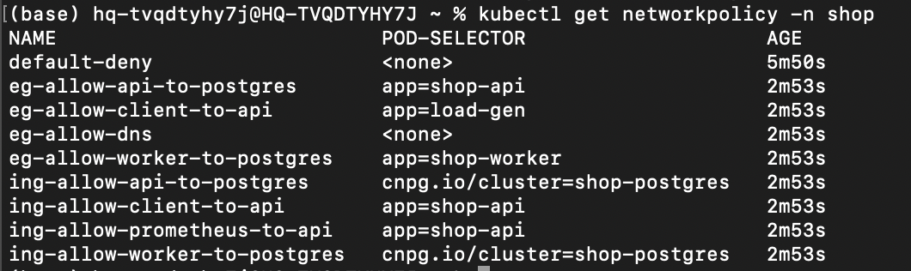
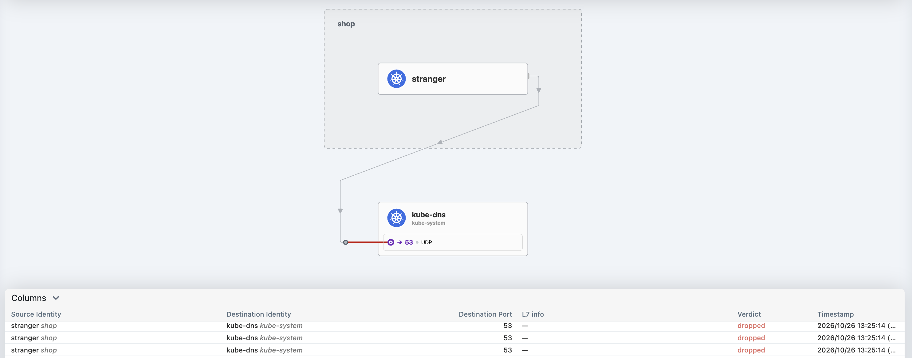
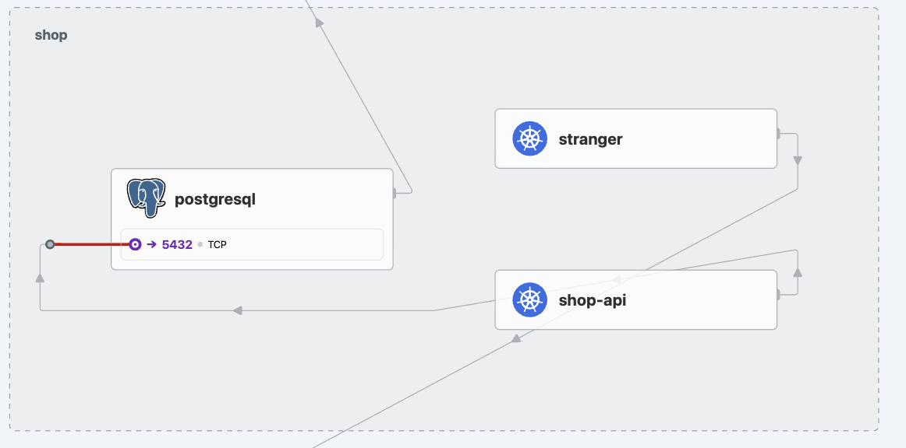
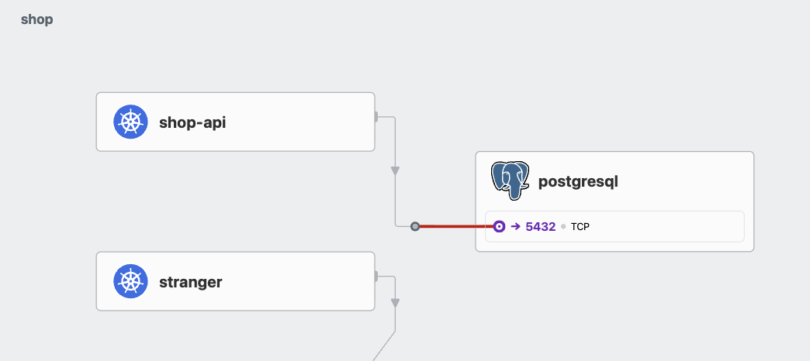
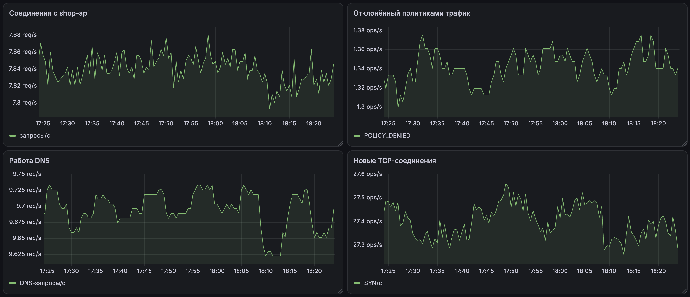
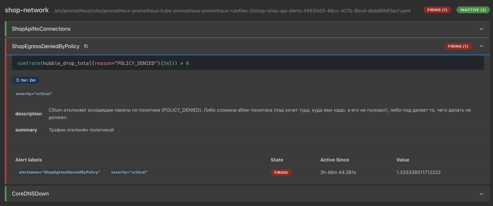
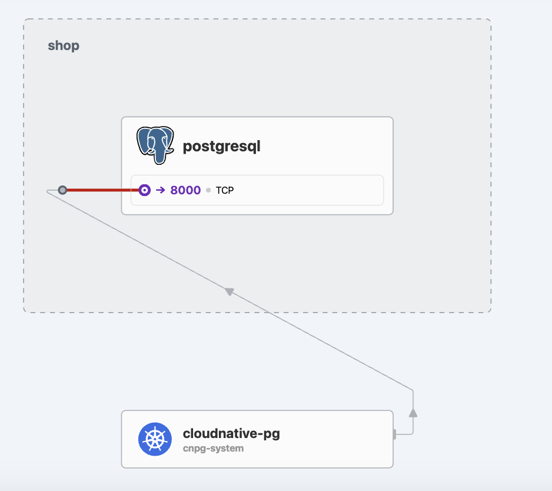
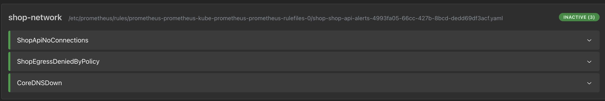
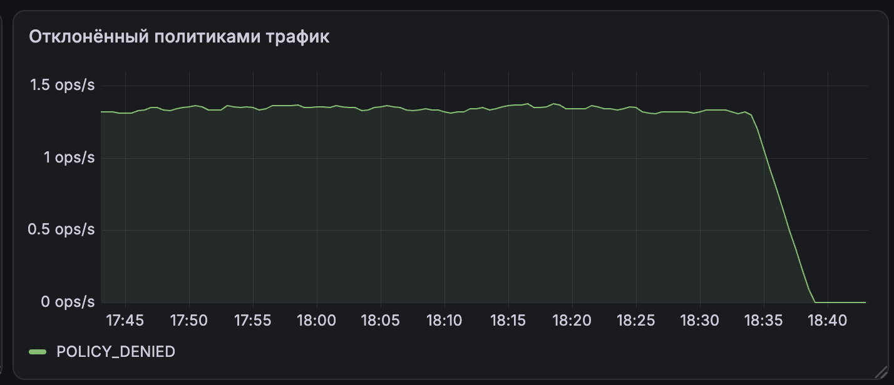

# Лабораторная работа №5 — Zero-trust сеть с доказательством

## Часть 0 — Выбор CNI

Сначала разберёмся, зачем вообще что-то выбирать

В Kubernetes есть штука под названием NetworkPolicy - это правила вида «кто к кому может ходить». Но сам Kubernetes эти правила не исполняет. Их исполняет специальный плагин CNI. А в k3d по умолчанию стоит flannel, который на эти правила просто забивает: правило ты создашь, а оно не будет работать. Поэтому нам нужен CNI, который умеет применять NetworkPolicy

Немного поресерчив, я выбрала **Cilium**. Почему:

1. Он реально применяет политики. Работает через eBPF - это такая штука, которая позволяет выполнять правила прямо в ядре Linux, быстро и надёжно.

2. У него есть Hubble - карта трафика. Hubble показывает, кто с кем общается и какие соединения блокируются. То есть я не буду гадать, а просто увижу проблему на карте

3. Может запрещать даже по приложению.

4. Вроде как он легко ставится:)

Calico - тоже нормальный и надёжный вариант, его часто используют. Но у него нет такой удобной карты трафика, как Hubble, а она мне точно пригодится

Поднимаю кластер без дефолтного CNI и без политик с двумя нодами

```bash
k3d cluster create lab5 \
  --servers 1 --agents 1 \
  --k3s-arg "--disable=traefik@server:*" \
  --k3s-arg "--flannel-backend=none@server:*" \
  --k3s-arg "--disable-network-policy@server:*"
```

Затем ставлю Cilium

```bash
helm repo add cilium https://helm.cilium.io/
helm repo update
helm install cilium cilium/cilium \
  --namespace kube-system \
  --set hubble.relay.enabled=true \
  --set hubble.ui.enabled=true
```

готово:


## Часть 1 - Разверни shop и исследуй сеть пода

Развернула чарт shop

Теперь нужно заглянуть под капот сети. Сначала зашла внутрь пода api и посмотрела его сеть:

```bash
kubectl exec -it -n shop deploy/shop-api -- sh
# внутри пода:
ip addr show eth0
ip route
```

Вот что увидела:


Много всего, разберемся что это:

- **10.0.1.151/32** - это IP пода
- **eth0@if38** - выглядит страшно, но это самая важная деталь. @if38 значит что eth0 - это один конец veth-пары, а второй конец - интерфейс с номером 38 на ноде. Это и есть тот самый парный veth
- **default via 10.0.1.231** - шлюз по умолчанию. Это адрес Cilium-интерфейса на ноде, через который под ходит наружу.

Теперь вышла из пода и зашла на ноду, где живёт этот под (k3d-lab5-server-0):

```bash
exit
docker exec -it k3d-lab5-server-0 sh
ip link show
```

На ноде нашла интерфейс с номером 38:


Это и есть второй конец нашей veth-пары. Итого пара выглядит так:

- **Внутри пода:** eth0 индекс 37 с IP 10.0.1.151
- **На ноде:** lxcae65d246847a (индекс 38)

Заодно на ноде глянула и другие интерфейсы Cilium:

- **cilium_host и cilium_net** - виртуальная пара для трафика самой ноды
- **cilium_vxlan** - туннель VXLAN, через который Cilium ходит между нодами 
- **lxc_health** - интерфейс для health-проверок Cilium

Теперь посмотрю, что поды на разных нодах видят друг друга напрямую по IP

Взяла под на ноде agent-0 (IP 10.0.0.127) и пинганула под на другой ноде server-0 (IP 10.0.1.151) напрямую по IP

```bash
kubectl exec -it -n shop shop-api-7d785fdd4c-298bw -- sh
# внутри пода:
ping -c 3 10.0.1.151
```

Результат:


под на одной ноде видит под на другой ноде напрямую по IP, без всяких Service. Это и есть плоская сеть Kubernetes

## Часть 2 - Докажи непрерывность через хаос подов

Вынесла api наружу через NodePort. Для этого поменяла тип сервиса shop-api с ClusterIP на NodePort и задала порт 30080


**чем NodePort отличается от LoadBalancer и headless-сервиса?**

- **ClusterIP** - сервис доступен только внутри кластера по виртуальному IP. Снаружи не достать
- **NodePort** - поверх ClusterIP открывает один и тот же порт на каждой ноде кластера. Снаружи можно достучаться как `http://<ip-любой-ноды>:<nodePort>`
- **LoadBalancer** - поверх NodePort просит у облачного провайдера внешний IP. Клиент ходит на один стабильный внешний адрес, а балансировщик уже распределяет по нодам
- **headless-сервис** - у него нет виртуального IP и балансировки: DNS возвращает сразу IP всех подов. Нужен, когда клиент хочет сам обращаться к конкретным подам

Написала два скрипта:

- **chaos.sh** - раз в 3 секунды убивает случайный под api или worker
- **load.yaml** - под-генератор нагрузки, который в цикле долбит сервис shop-api по DNS-имени и логирует ошибки

Запускаю хаос и нагрузку параллельно, смотрю логи load-gen и график в Grafana


Сначала нагрузка падала. Получала Connection reset by peer. Под убивали жёстко, а api не умел graceful shutdown. Запрос, который был в полёте к убитому поду, просто рвался. Добавила в api graceful shutdown: ловлю SIGTERM, даю текущим запросам доехать, потом выхожу.

После фикса запустила хаос еще раз.Теперь нагрузка идёт без единого фейла, пока поды умирают и пересоздаются


Почему это вообще сработало?

Клиент ходит на сервис по имени shop-api, а не по IP пода. За непрерывность отвечает связка из нескольких частей сетевого стека:

- Service - стабильная точка входа: виртуальный IP и DNS-имя, которые не меняются
- EndpointSlice - список живых подов за сервисом. Когда под умирает, его убирают из EndpointSlice, когда создаётся новый - добавляют. Клиент всегда попадает на живой под
- kube-proxy - смотрит на EndpointSlice и обновляет правила пересылки трафика на актуальные поды
- DNS - резолвит имя shop-api в ClusterIP сервиса

**Режим kube-proxy**

У меня k3s и по умолчанию там используется iptables-режим. Разница с IPVS:

- iptables - правила пересылки на каждый сервис/под. При большом числе сервисов правил становится много и обновление может быть медленным
- IPVS - использует ядерную таблицу балансировки, масштабируется лучше, быстрее обновляется при большом числе сервисов

Для этой лабы (всего несколько сервисов) разница незаметна. Но если сервисов сотни, то  IPVS будет получше

## Часть 3 - Целевая матрица доступа

Решила теперь наконец заглянуть в Hubble, что прикинуть матрицу. UI там выглядит очень даже симпатично


В итоге собрала вот такую табличку

| Источник \ Назначение | api | worker | postgres | DNS |
|---|---|---|---|---|
| **клиент** (load-gen) | ✅ 8080 | ❌ | ❌ | ✅ 53 |
| **api** | ❌ | ❌ | ✅ 5432 | ✅ 53 |
| **worker** | ❌ | ❌ | ✅ 5432 | ✅ 53 |
| **Prometheus** (monitoring) | ✅ 9090 (metrics) | ❌ | ❌ | ❌ |
| **посторонний под** | ❌ | ❌ | ❌ | ❌ |

Пояснения:

- клиент → api (8080) - единственный вход в систему
- api → postgres (5432) и worker → postgres (5432) - работа с бд
- клиент/api/worker → DNS (53) - резолв имён. Без этого сервисы не найдут друг друга по имени.
- Prometheus → api (9090) - скрейпит метрики через ServiceMonitor. Порт 9090 - это metrics-порт сервиса shop-api, который форвардится на 8080 пода
- посторонний под → postgres - нельзя, это главная цель zero-trust: никто, кроме api/worker, не должен достучаться до БД.
- Всё остальное (api↔worker, api→api и т.д.) - нельзя, по умолчанию всё запрещено.

## Часть 4 - Включи zero-trust

Реализовала матрицу как шаблоны NetworkPolicy в чарте shop. Значения вынесла в values.yaml

Структура шаблонов в чарте:

- **networkpolicy-default-deny.yaml** - запрещает весь трафик по умолчанию
- **networkpolicy-ingress.yaml** - рендерит входящие правила из values.networkPolicy.ingress
- **networkpolicy-egress.yaml** - рендерит исходящие правила из values.networkPolicy.egress

В values.yaml описала правила по матрице:

- ingress: клиент → api (8080), Prometheus → api (8080), api → postgres (5432), worker → postgres (5432).
- egress: клиент → api (8080), api → postgres (5432), worker → postgres (5432), DNS → kube-system (53).

С чем немного пришлось повозиться:

- default-deny - пустой podSelector: {} и пустые правила = запретить всё. Без него политики только добавляли бы разрешения, а не закрывали лишнее
- DNS обязателен - без egress-правила на kube-dns (порт 53) api/worker не смогут резолвить имена и всё ломается
- Prometheus из другого namespace - для него использовала namespaceSelector, т.к он живёт не в shop.
- podSelecto требует matchLabels - сокращённая форма podSelector: {app: shop-api} не работает, Kubernetes ругается(( Нужно podSelector: {matchLabels: {app: shop-api}}

проверю, что все политики применились:



## Часть 5 - Докажи матрицу на практике

Теперь буду вручную проверять матрицу... из каждого пода попробовала достучаться до каждого адресата и свела результат в таблицу

Для проверки создала посторонний под **stranger** - у него по матрице нет доступа ни к кому

Проверяла соединения так:
- **api** - wget http://shop-api/orders (HTTP) или nc -z <адрес> <порт> (TCP).
- **postgres** - nc -z shop-postgres-rw 5432
- **worker** - nc -z <ip-worker-пода> 8080
- **DNS** - nslookup <имя>

и тут были проблемы...

Сначала я проверила, что stranger не может достучаться до postgres. И тут меня ждал сюрприз: **stranger спокойно резолвил DNS-имена**

моё egress-правило на DNS имело podSelector: {}, то есть разрешало DNS всем подам в namespace, включая stranger. В моменте я думала ну DNS же всем нужен, а по матрице stranger не должен иметь доступа ни к чему, даже к DNS

В итоге добавила подам api/worker/load-gen общий лейбл net.allow-dns: "true" и ограничила DNS-политику только ими

После этого stranger → DNS стал недоступен, проверила это еще и в Hubble



(kube-dns изначальноо прятался, пришлось поковыряться чтобы его отображать)

Дальше стала проверять, что api и worker могут достучаться до postgres. И тут выяснилось, что postgres сам в беде.... после включения default-deny он потерял доступ к apiserver, а CNPG-оператору это нужно для readiness-проб и reconciliation. В логах postgres было:

```
readiness probe using cached cluster definition due to API server connectivity issue
apiServerReachable: false
apiServerErr: Get "https://10.43.0.1:443/...": context deadline exceeded
```

Здесь я ооочень долго намучилась, но в итоге нужна была CiliumNetworkPolicy с toEntities: kube-apiserver. Создала шаблон ciliumnetworkpolicy-postgres-apiserver.yaml

После этого все заработало как ожидалось

Еще была проблема, что когда я проверяла DNS, я использовала nslookup shop-api. И оно возвращало ошибку:

```
** server can't find shop-api.cluster.local: NXDOMAIN
** server can't find shop-api.svc.cluster.local: NXDOMAIN
Name: shop-api.shop.svc.cluster.local
Address: 10.43.190.163
```

Я уже думала, что DNS сломан. Но там на самом деле nslookup просто сначала пробует короткое имя, а потом резолвит полное имя shop-api.shop.svc.cluster.local в 10.43.190.163. Из-за NXDOMAIN exit code = 1, хотя резолв прошёл

тогда стала проверять реальным запросом wget http://shop-api/orders. Если имя резолвится и соединение проходит, то DNS работает

**Итоговая матрица**

После всех фиксов прогоняю матрицу заново, все как и хотелось

| Источник \ Назначение | api | worker | postgres | DNS |
|---|---|---|---|---|
| **клиент** (load-gen) | ✅ работает | ❌ | ❌ | ✅ работает |
| **api** | ❌ | ❌ | ✅ работает | ✅ работает |
| **worker** | ❌ | ❌ | ✅ работает | ✅ работает |
| **посторонний под** (stranger) | ❌ | ❌ | ❌ | ❌ |

## Часть 6 — Найди скрытую поломку связности

Написала скрипт break.sh, который случайно выбирает одну из 4 поломок и применяет её

| Вариант | Что ломает |
|---|---|
| `break-port` | неверный порт в eg-allow-api-to-postgres (5432 → 5433) |
| `break-labels` | неверный лейбл в eg-allow-api-to-postgres (shop-api → shop-worker) |
| `break-dns` | удаляет eg-allow-dns (нет резолва имён) |
| `break-client-port` | неверный порт в ing-allow-client-to-api (8080 → 8081) |

Скрипт бэкапит values.yaml, применяет поломку, переприменяет чарт

**Первый запуск**

Запустила ./break.sh

**1. Симптом.** Проверила поток заказов: `api → postgres` не проходит, `client → api` тоже, но `worker → postgres` работает. Заказы перестали проходить.

**Первый запуск**

Запустила ./break.sh

Первым делом проверила поток заказов api → postgres не проходит, client → api тоже

Тогда решила посмотреть карту Hubble



```
shop-api-* → shop-postgres-1:5432 | DROPPED POLICY_DENIED
```

Все 5 подов api дропаются при попытке достучаться до postgres на порту 5432

Порт в правиле 5433, а api реально ходит на 5432. Правило разрешало не тот порт, поэтому соединение дропалось

Это было просто, поэтому решила попробовать еще раз

**Второй запуск**

Здесь получилась та же картина api → postgres не проходит и в хабле опять увидела 



Естественно сначала проверила порт, он был верным, стала смотреть дальше и нашла проблему с лейблом


```
{"matchLabels":{"app":"shop-worker"}}
```

вместо app: shop-api. Из-за этого api не попадал под правила и api → postgres блокировался

Вернула лейбл app shop-api в podSelector, переприменила чарт. Матрица снова зелёная:)

## Часть 7 — Мониторинг

По заданию нужны три метрики

| Метрика | Источник | Как включила |
|---|---|---|
| Соединения | `shop_api_http_requests_total` | уже была в api |
| Отклонённый политиками трафик | `hubble_drop_total{reason="POLICY_DENIED"}` | включила метрики Hubble в Cilium |
| Работа DNS | `coredns_dns_requests_total` / `up{job="coredns"}` | уже скрейпится стеком |

Метрик Hubble в Prometheus не было, поэтому:

1. Включила метрики Hubble в Cilium:
   ```
   helm upgrade cilium cilium/cilium --version 1.20.4 -n kube-system \
     --reuse-values --set hubble.metrics.enabled="{drop,flow,dns,tcp}"
   ```
2. Добавила Service cilium-hubble-metrics (kube-system, порт 9965) и ServiceMonitor cilium-hubble, Prometheus стал скрейпить обе ноды

Для начала собрала дашборду

| Панель | Запрос | Что показывает |
|---|---|---|
| Соединения с shop-api | `sum(rate(shop_api_http_requests_total[5m]))` | общий поток запросов к api |
| Новые TCP-соединения | `sum(rate(hubble_tcp_flags_total{flag="SYN"}[5m]))` | новые TCP-соединения через Cilium |
| Отклонённый политиками трафик | `sum(rate(hubble_drop_total{reason="POLICY_DENIED"}[5m]))` | пакеты, срезанные политикой |
| Работа DNS | `sum(rate(coredns_dns_requests_total[5m]))` | общий поток DNS-запросов |



Здесь я немного не поняла, откуда у меня идет трафик, который отклоняют... но пока пошла дальше

В prometheusrule.yaml заложила 3 алерта

| Алерт | Выражение | Severity | Обоснование |
|---|---|---|---|
| `ShopApiNoConnections` | `sum(rate(shop_api_http_requests_total[5m])) == 0` | warning | Нет ни одного соединения с api за 5 минут - либо клиент (load-gen) остановлен, либо api недоступен по сети. |
| `ShopEgressDeniedByPolicy` | `sum(rate(hubble_drop_total{reason="POLICY_DENIED"}[5m])) > 0` | critical | Cilium режет исходящие пакеты по политике. Значит либо сломана allow-политика (под хочет туда, куда ему надо, а его не пускают), либо под делает то, чего делать не должен |
| `CoreDNSDown` | `up{job=~".*coredns.*"} == 0` | critical | CoreDNS не отвечает на scrape. Без DNS сервисы не найдут друг друга по имени — ломается вся сеть кластера |

На этом моменте мне нужно было спровоцировать алерт. Но я заметила, что `ShopEgressDeniedByPolicy` уже горит....



Пошла расследовать... Заглянула в Hubble и вот что увидела



CNPG-оператор → shop-postgres-1:8000 (status-порт). Оператор опрашивает статус инстанса postgres, а политика не разрешает. Не поняла, в какой момент я это проморгала

Добавила в values.yaml ingress-правило `ing-allow-cnpg-operator-to-postgres`

```yaml
- name: ing-allow-cnpg-operator-to-postgres
  podSelector:
    matchLabels:
      cnpg.io/cluster: shop-postgres
  from:
    - namespaceSelector:
        matchLabels:
          kubernetes.io/metadata.name: cnpg-system
      podSelector:
        matchLabels:
          app.kubernetes.io/name: cloudnative-pg
  ports:
    - port: 8000
```

и все пофиксилось:) Так что полезность алертов увидела сразу же на практике

Алерты больше не горят



И отклоненного трафика больше нет




