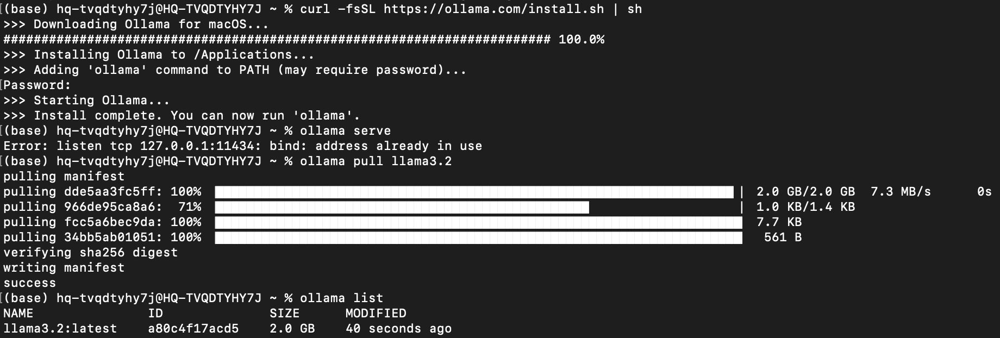
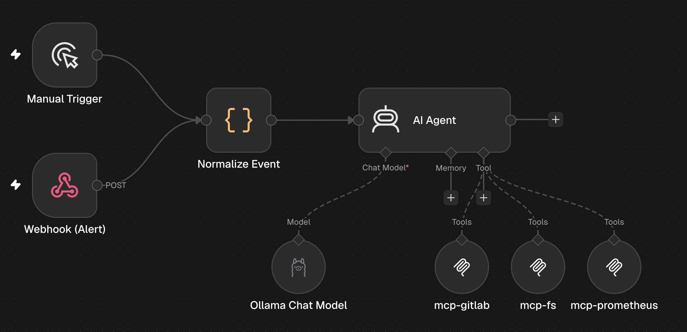
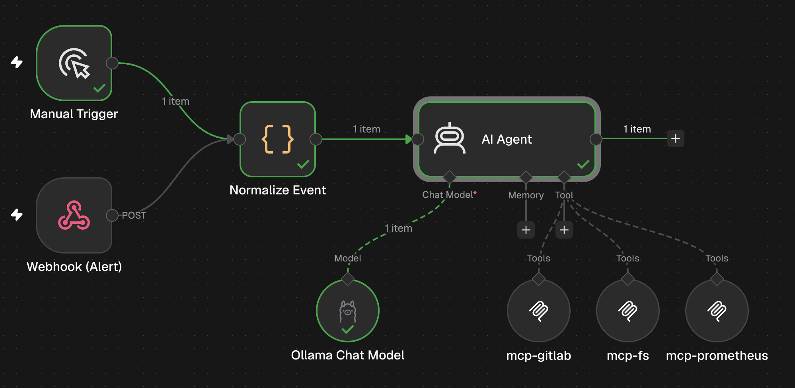
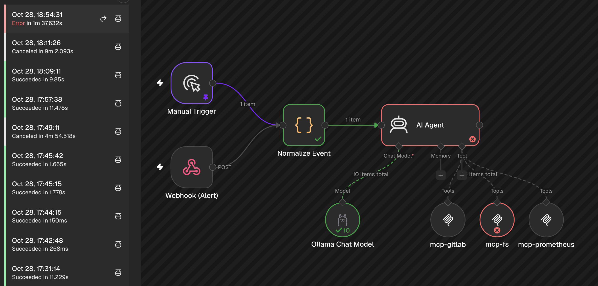
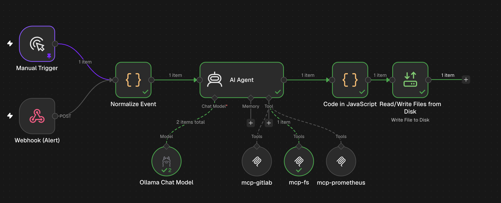
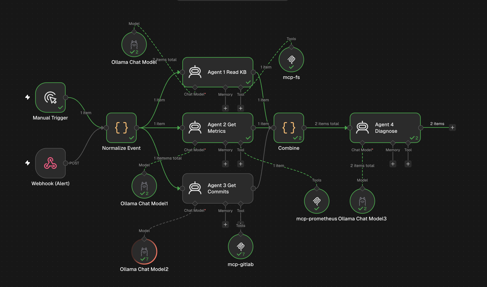
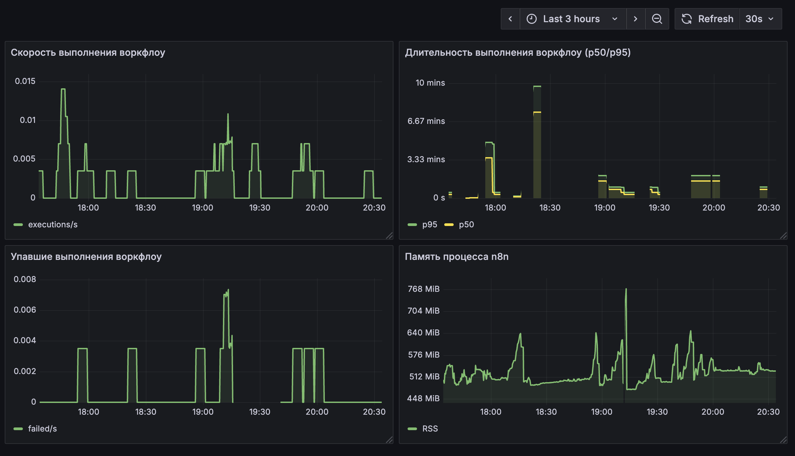
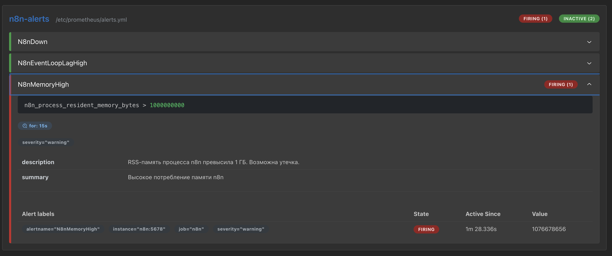

# Лабораторная работа №7 — Автоматизация devops-процесса с n8n + AI

## Часть 1 — Придумай кейс

Здесь я решила убить одной работой двух зайцев:) Тема моей НИР — «ИИ-агент диагностики инцидентов в микросервисном бэкенде на основе наблюдаемости и базы эксплуатационных знаний». Поэтому кейс для лабы я решила взять такой же: сделать рабочий прототип ассистента, который помогает инженеру разбирать инциденты. Так лаба закрывает и учебную задачу, и продвигает моё исследование

**Компания.** Пусть это будет какой-то редний e-commerce с микросервисным бэкендом: каталог, корзина, заказы, оплата, доставка, рекомендации и прочее. Нагрузка неравномерная: в акции, распродажи, по праздникам и выходным трафик скачет в разы, и именно в эти моменты чаще всего что-то ломается

**Кому помогает.** Дежурному SRE-инженеру, разработчикам, да и в целом всей команде будет полезно. Мне как бэк разработчику тоже часто приходится работать с алертами, собирать контекст и расследовать ситуацию, поэтому какая-то автоматизация здесь точно лишней не будет

**Какую проблему решает.** При инциденте приходится вручную:
- смотреть метрики сервиса
- смотреть логи
- смотреть свежие коммиты и MR
- посмотреть по чатикам и доке, сталкивался ли кто-то с этим

Всё это разбросано по разным системам, а прошлые разборы инцидентов хранятся либо в чатах, либоо вообще нигде. В итоге на сбор контекста уходит довольно много времени

**Что делает автоматизация?**
- **Триггер:** срабатывание алерта + было бы круто еще и ручками запускать агента. Например, если разворачиваешь новый сервис (в тесте или алерты просто еще не настроены) и наблюдается какое-то странное поведение
- **Шаги:** собирается контекст по инциденту — метрики из Prometheus, свежие коммиты и MR из GitLab, похожие прошлые инциденты из базы эксплуатационных знаний. Затем агент анализирует всё это и выдаёт диагноз и что можно сделать/проверить
- **Результат:** отчёт-файл + запись разбора в базу эксплуатационных знаний, чтобы в следующий раз похожий инцидент разбирался быстрее

## Часть 2 — Что должно быть в реализации

Пройдусь по чек-листу

**Триггер.** У меня их два:
- webhook — срабатывание алерта из Alertmanager
- manual trigger — ручной запуск

Оба ведут в один и тот же пайплайн диагностики

**Шаги**
- Не-AI: нормализация входящего события, сбор контекста через MCP-серверы (метрики, коммиты/MR, поиск в базе знаний), формирование итогового отчёта
- AI: агент анализирует собранный контекст и выдаёт диагноз: что сломалось, что могло стать причиной, что проверить/сделать

**MCP-серверы**
1. Filesystem MCP — доступ к базе эксплуатационных знаний: поиск похожих прошлых инцидентов и запись новых разборов
2. GitLab MCP — свежие коммиты и MR в сервисе, чтобы связать инцидент с недавним деплоем
3. Prometheus MCP — метрики сервиса, чтобы понять, что именно просело

Все три работают по stdio, поэтому каждый обёрнут в `supergateway` (stdio → Streamable HTTP): MCP Client Tool в n8n подключается только по сети

**AI toolkit**

| Инструмент | Что делает | Вход |
|---|---|---|
| `get_metric` | тянет метрику из Prometheus | имя метрики, диапазон времени |
| `get_recent_commits` | свежие коммиты/MR из GitLab | репозиторий, ветка, количество |
| `search_kb` | ищет похожие инциденты в базе знаний | ключевые слова / симптомы |
| `write_kb_entry` | записывает новый разбор в базу знаний | текст разбора, имя файла |
| `read_file` | читает конкретный файл из базы знаний | путь к файлу |

**Описанные skills** 

Агент действует по инструкции: в каком порядке собирать контекст и по каким правилам формулировать диагноз. Порядок: сначала метрики, потом свежие коммиты/MR, затем сверка с базой знаний, и только потом диагноз + запись разбора. Описание лежит в skills/

**Конкретный результат**

Отчёт-файл с диагнозом и рекомендациями + запись разбора в базу эксплуатационных знаний, чтобы в следующий раз похожий инцидент разбирался быстрее

## Часть 3 — Запусти локально

### Структура проекта

Организовала структуру

```
├── knowledge-base/           # база эксплуатационных знаний (читает Filesystem MCP)
│   └── incidents/            # прошлые разборы инцидентов
│       ├── 2026-08-20-delivery-queue.md
│       ├── 2026-09-14-catalog-memory-leak.md
│       └── 2026-10-01-orders-latency.md
├── test-service/             # тестовый микросервис (git-репозиторий)
│   ├── go.mod
│   ├── main.go
│   └── .gitignore
├── stand/                    # стенд: docker-compose и конфиги
│   ├── docker-compose.yaml
│   ├── prometheus.yml
│   └── .env.example
```
я подготовила базу знаний — три файла с прошлыми разборами инцидентов.

Чтобы было что диагностировать, я сгенирировала простой Go-сервис каталога с кэшем товаров. Это отдельный git-репозиторий с двумя ветками:

- main — рабочая версия: кэш ограничен 1000 записей, старые записи вытесняются
- feature/broken — коммит убрал вытеснение, поэтому кэш растёт бесконечно

Дальше поставила Ollama и модельку llama3.2



весь стенд собран в одном docker-compose

| Сервис | Образ | Назначение | Порт на хосте |
|---|---|---|---|
| `n8n` | `n8nio/n8n:1.80.3` | оркестрация workflow | 5678 |
| `mcp-fs` | `supercorp/supergateway:4.2.1` | Filesystem MCP (база знаний) | — |
| `mcp-gitlab` | `zereight050/gitlab-mcp` | GitLab MCP (коммиты/MR) | — |
| `mcp-prometheus` | `supercorp/supergateway:4.2.1` | Prometheus MCP (метрики) | — |
| `prometheus` | `prom/prometheus` | сбор метрик | 9090 |
| `grafana` | `grafana/grafana` | дашборды | 3000 |

Теперь поднимаю стенд и настраиваю workflow в n8n

Открыла n8n на `http://localhost:5678`, создала аккаунт и собрала workflow. Получилась такая схема:



**Триггеры.** У меня их два:
- **Manual Trigger** — ручной запуск диагностики
- **Webhook (Alert)** — приём алерта методом POST (так их шлёт Alertmanager)

Оба ведут в один узел **Normalize Event** — он приводит данные из любого триггера к единому виду (service, symptom, severity, source)

**AI Agent** — сердце workflow. К нему подключены:
- **Ollama (llama3.2)** — локальная модель
- **mcp-fs** — Filesystem MCP (база знаний)
- **mcp-gitLab** — коммиты и MR
- **mcp-prometheus** — метрики

В System Message агента я прописала его know-how: в каком порядке собирать контекст (метрики → коммиты → база знаний → диагноз) и по каким правилам

Дальше начались проблемы((( Агент никак не хотел пользоавться своими тулами и просто писал отсебятину



Сначала попробовала поменять модель на qwen2.5:3b, стало только хуже. Агент даже отсебятину перестал писать.

Тогда еще долгое время пожонглировала с промптами, поставила настройку **Force Tool Call on First Iteration** и модель поменяла на qwen2.5:7b

И наконец увидела красный свет на mcp гитлаба!!!



Красный свет - это конечно плохо, но было очень радостно, что агент наконец-то решил пользоваться тулами.

У mcp проблемы была с местом хранения отчета, пришлось использовать отдельный модули для его записи: модуль по конвертации в бинарник и непосредственно модуль для сохранения отчета в папку

Теперь все зелененькое и файл с отчетом сохранился!!!



Здесь оставалась еще проблема, что агент использует только один тул. Но исправить это с текущей моделью не получилось( Она теряла контекст и не могла работать в режиме с несколькими тулами....

Нужна модель посильнее, но локально ничего лучше я поднять не могу. А облачные решения по условиям лабы вроде как не приветствуются и нужна локальная модель.

Тогда я решила попробовать костыльное решение с мульти агентами.

Собрала такого монстра



Здесь получается, что каждый агент ходит только в 1 тул, у него нет другого выбора. И один итоговый агент формирует готовый отчет. Это сработало)

## Часть 4 — Мониторинг системы

Теперь буду мониторить сам n8n** — оркестратор всего стенда


n8n умеет отдавать метрики в формате Prometheus на `/metrics` — для этого в docker-compose включена переменная `N8N_METRICS=true`. Prometheus скрейпит n8n раз в 15 секунд:

```yaml
scrape_configs:
  - job_name: "n8n"
    metrics_path: /metrics
    static_configs:
      - targets: ["n8n:5678"]
```

### Какие метрики важны

n8n отдаёт много метрик, я собрала дашборду из нескольких

| Метрика | Тип | Что показывает |
|---|---|---|
| `n8n_workflow_execution_duration_seconds` | histogram | сколько времени выполняются воркфлоу (p50/p95) |
| `n8n_workflow_execution_duration_seconds_count` | counter | сколько выполнений прошло |
| `n8n_process_resident_memory_bytes` | gauge | потребление памяти процессом |



Алерты настроены в Prometheus (`prometheus.yml` → `rule_files`). Выбрала три метрики, которые покрывают разные типы проблем: отказ, деградация и утечка.

**1. n8n недоступен** — `up{job="n8n"} == 0`

Самое критичное: если Prometheus не может доскрейпить n8n, значит сервис лежит и вся автоматизация встала

**2. Высокая задержка event loop** — `n8n_nodejs_eventloop_lag_seconds > 1`

Event loop Если он заблокирован больше секунды, n8n перестаёт отвечать на запросы, хотя процесс формально жив

**3. Рост памяти процесса** — `n8n_process_resident_memory_bytes > 1e9` (1 ГБ)

Память растёт при утечках или накоплении данных в воркфлоу. Это алерт на утечку (resource leak) — позволяет поймать проблему до OOM-kill

Дала большую нагрузку, вызвала рост памяти и спровоцировала алерт

